# Car rental vertical: target architecture

Status: proposal, for review. Written 10 Nov 2026 after reading the code on `main` (Phases 0–4b).
Markets: **United States** and **GCC** (UAE: Dubai and Sharjah; Qatar; Oman).
Companion docs: [booking-flow.md](./booking-flow.md) (the configurable car booking flow),
[market.md](./market.md) (competitors) and [dev-plan.md](./dev-plan.md) (phases).

---

## 0. TL;DR

1. **Keep what already scales.** Postgres row-level security tenancy, composite `(tenant_id, id)` keys,
   `withTenant()`, a pure `core` pricing engine, DB-enforced availability under a lock, idempotent
   message outbox, graphile-worker, price locks and audit partitions. These are the right foundations
   and car rental reuses all of them.
2. **Fix the coupling before adding a second vertical.** Today `@rental/db` is the schema *and* every
   domain service behind one barrel. `orders.ts` (1,241 lines) calls messaging, money, catalog and
   customers directly, and `@rental/messaging` / `@rental/payments` reach into `schema`. If cars is
   added in the same style, events and cars become one ball of mud.
3. **Target shape:** a **modular monolith of bounded contexts**. It has a shared *platform* (tenancy,
   identity, parties, locations, availability, commerce, tax, documents, messaging, files, audit,
   integrations, agents) and two *vertical packs* (`events`, `cars`). Each context publishes a
   **contract** (zod commands, queries, versioned domain events, error codes) and hides its tables.
   Contexts talk synchronously through contracts and asynchronously through a **transactional outbox**.
   Boundaries are enforced in CI.
4. **Regional cells.** Run one `us-east` cell (today's stack) and one `me-central` cell (UAE) for
   data residency and latency. A tiny global control plane maps each workspace slug to its cell.
   Each cell runs the same code with different provider adapters.
5. **GCC realities are design inputs, not add-ons:**
   - money with per-currency exponents (OMR has 3 decimals);
   - VAT with immutable tax invoices and credit notes;
   - Salik/Darb tolls and police fines arriving weeks after return;
   - local card gateways (Stripe does not onboard Qatar businesses);
   - Arabic RTL, WhatsApp, Fri–Sat or Sat–Sun weekends, and e-invoicing (UAE PINT AE, Oman Fawtara).
6. **Agents are first-class, governed principals.** Every agent acts only through the same contract
   commands as staff. A tool gateway checks a per-tenant policy (allow / needs approval / deny),
   with autonomy levels, budgets, a kill switch, dry-run previews, full run logs and evals. A person
   approves anything that moves money, makes a damage claim or cancels a confirmed rental, until a
   tenant chooses otherwise within platform limits.

---

## 1. What the current repo gets right (keep)

| Area | Today | Why it matters for cars |
| --- | --- | --- |
| Tenancy | RLS on every tenant table, non-owner `rental_app` role, `app.tenant_id` set per transaction, composite FKs, 404-not-403 | Same isolation for fleet, drivers and ID documents (higher-risk data) |
| Location scope | `app.location_ids` GUC, enforced by RLS | Branch-limited counter staff (airport vs city branch) |
| Pure domain core | `@rental/core`: pricing, settings (versioned zod JSON), permissions matrix, regional detection, time | Rate engine and eligibility rules go here. They run in the browser for instant quotes and are re-checked on the server |
| Availability | `app_reserve…` SQL function, `pg_advisory_xact_lock` per product+location, `btree_gist` already installed | Same "fast read, strict write" approach, extended to serialized vehicles with exclusion constraints |
| Price locks | Saved order prices never move when settings change | Rate-plan changes must not change a confirmed reservation |
| Versioning | `orders.version` optimistic check, `order_versions` diff history | Rental agreement amendments (extension, vehicle swap) |
| Messaging | Outbox with `org + key` idempotency, scheduled rows, worker `dispatch_due`, tenant SMTP/SMS | Pickup reminders, return-time alerts, fine notices; add WhatsApp |
| Money ops | Reconcile job against Stripe, refund planning, overpayment handling | Deposit holds, captures, post-rental charges |
| Mutation gate | `assertWritable` (suspended / impersonation), `ActionResult`, `run()` | Same gate guards agent actions |
| Ops | CI with real PG17, nightly backups to R2, per-phase branches, e2e scripts, parity script | Keep the discipline. Cars gets its own golden-case suite |
| Field app | Coach portal PWA: checklists, photos, GPS, phases | Generalize into a **field app** for check-out/check-in inspections and delivery drivers |

## 2. What must change (findings)

| # | Finding (evidence) | Consequence | Fix in target |
| --- | --- | --- | --- |
| F1 | `@rental/db/src/index.ts` re-exports 20 services, and `orders.ts` imports `messaging`, `money`, `catalog`, `customers` | Every change ripples, and there are no seams to add cars | Bounded contexts with contracts and an outbox (section 4) |
| F2 | `@rental/messaging` and `@rental/payments` import `schema` and read `payments` / `smsAccounts` tables directly | Hidden coupling to table shapes | Contexts own their tables. Others call queries |
| F3 | `orders` is event-shaped (`event_starts_at`, `setup_surface`, `damage_waiver`, `coach_notes`). Roles include `coach` and `crew`. Service modes are staffed / pickup / dropoff | Cars cannot reuse `orders` without nullable sprawl | Split into a vertical-neutral **Commercial order** (money lines) and a vertical aggregate (EventBooking / Reservation + RentalAgreement) |
| F4 | Availability is quantity per product per location | Cars book a **class** and later assign a **VIN**. They also need one-way trips, turnaround buffers and maintenance blocks | Availability engine with pooled, class and serialized strategies (section 6) |
| F5 | Money is `*_cents` everywhere, and formatting assumes 2 decimals | OMR (and later KWD, BHD) uses 3 decimals, so amounts break | Kernel `Money {minor, currency}` with ISO 4217 exponents |
| F6 | Invoices "re-sync on every change" (conflict log #24) | Not allowed for a GCC tax invoice, which is immutable once issued | Issue, then adjust only by credit or debit note |
| F7 | One `tax_percent` per order or location | US car rental has stacked surcharges (state rental tax, airport concession recovery, vehicle licence fee). GCC needs VAT with a TRN on the invoice | Tax engine with multi-component jurisdictions |
| F8 | Stripe is the only gateway, and the flow is charge plus saved card for the balance | No authorization holds, incremental auths or post-rental merchant-initiated charges, and no Qatar or Oman merchants | `PaymentGateway` port with capability flags and GCC adapters |
| F9 | No i18n library, no RTL, and `COUNTRY_DEFAULTS` has AE but not QA or OM | Arabic UI, emails and invoices are required in the GCC | i18n with ICU messages, logical CSS properties, bilingual documents |
| F10 | Single region (US East: Supabase, Vercel, Railway) | GCC latency, plus PDPL / PDPPL residency and transfer exposure | Cell architecture (section 8) |
| F11 | No public API, webhooks or agent tool surface. Side effects run inline | Agents and integrations would call internals | Contracts generate the API, webhooks and MCP tools |
| F12 | Worker cron jobs scan all tenants on one queue (`concurrency: 3`) | Large tenants starve small ones, and telematics floods would block payments | Named queues by priority, per-tenant fairness, a separate ingest service |

---

## 3. Architecture principles

1. **Domain first.** Code is organised by business capability (bounded context), not by technical
   layer. Ubiquitous language per context: *Reservation* is not *Agreement*, and *Vehicle* is not
   *Product*.
2. **High cohesion.** A context owns its tables, its rules, its state machine and its UI fragments.
   A change to fuel-charging rules touches one context.
3. **Low coupling.** Contexts know each other only through published contracts. Synchronous calls are
   allowed only for queries and for commands that must share the caller's transaction (rare and listed).
   Everything else goes through domain events.
4. **Explicit contracts.** Contracts are zod schemas plus TypeScript types, versioned (`cars.ReservationConfirmed.v1`).
   Breaking changes add a new version; old consumers keep working.
5. **Pure core, thin shell.** Pricing, eligibility, settlement and policy evaluation are pure
   functions. They are unit-tested and run in the browser and on the server. I/O lives in
   `app/` handlers and `infra/`.
6. **Fast read, strict write.** Reads come from projections and caches. Writes re-check invariants
   inside the database under lock or with an exclusion constraint.
7. **Same rules for humans and agents.** One command path, one permission check, one audit trail.
   The agent is just another principal with tighter limits.
8. **Modular monolith first.** Extract a service only for a different scaling or compliance profile:
   telematics ingestion, AI vision inference and possibly e-invoicing. Contracts make that extraction
   mechanical.
9. **Region is a tenant attribute.** Data lives where its tenant lives. Code is the same in every cell.

---

## 4. Context map

```mermaid
flowchart LR
  subgraph Platform["Platform (shared kernel + shared contexts)"]
    K[kernel: Money · Time · Geo · Ids · Contract helpers]
    TEN[Tenancy & Cells]
    IAM[Identity & Access + Agent principals]
    LOC[Locations / Branches / Zones]
    PTY[Parties: customers, companies]
    AV[Availability engine]
    COM[Commerce: orders, invoices, payments, deposits, ledger]
    TAX[Tax & e-invoicing]
    DOC[Documents & Signatures]
    MSG[Messaging: email · SMS · WhatsApp]
    FIL[Files & Media]
    AUD[Audit]
    INT[Integrations: API · webhooks · MCP]
    AGT[Agent runtime & policy]
  end
  subgraph Events["Events vertical"]
    EB[Event booking]
    EC[Event catalog & pricing]
    EO[Event ops: coaches, crew, surfaces, rain checks]
  end
  subgraph Cars["Car rental vertical"]
    FL[Fleet]
    RT[Rates & products]
    RS[Reservations]
    RA[Rental agreements]
    DR[Drivers & KYC]
    IN[Inspections & damage]
    TF[Tolls & fines]
    MT[Maintenance]
    TL[Telematics]
    CH[Channels / distribution]
  end
  Events -->|contracts| Platform
  Cars -->|contracts| Platform
  Events -.x.- Cars
```

Rule: **verticals never depend on each other.** Cross-sell (a wedding booking with a luxury car)
happens in the UI or through events, never through imports.

### 4.1 Shared vs vertical-specific

| Capability | Platform (shared) | Events | Cars |
| --- | --- | --- | --- |
| Workspace, branding, onboarding | ✓ (+ `verticals[]`, `home_cell`) | onboarding steps | fleet import step, branch types (airport, city, delivery-only) |
| Locations | branch, timezone, hours, tax jurisdiction, **zones** (airport, hotel, delivery polygons) | warehouse / ship-from | rental branch, return-to-any, after-hours key drop |
| Customers | person or company, contacts, addresses, tags, consent, blacklist flag | event address | links to **driver profiles** (KYC lives in cars) |
| Catalog | — | products, packages, staffed / pickup / dropoff prices | vehicle **classes** (ACRISS), extras, protection products |
| Assets | serialized units (generic) | inventory units (bounce houses) | **vehicles** (VIN, plate, emirate or state, Mulkiya or registration, insurance, Salik tag) |
| Availability | engine: pooled / class / serialized, buffers, blocks, locks | product pools | class capacity, VIN assignment, one-way, maintenance blocks |
| Pricing | Money, rounding, discounts, coupons, credits, price locks, tax hook | event package + overtime formula (Odoo parity) | **rate plans** (day, week, month, weekend, seasonal, length-of-rental tiers), mileage caps, one-way fees, young-driver surcharges |
| Order lifecycle | commercial order: lines, totals, versions | EventBooking state machine (draft → sent → sale → done) | **Reservation** (class) → **RentalAgreement** (VIN, out/in readings) |
| Payments | gateway port, authorize / capture / void / refund, saved cards, reconcile, ledger | deposit + event-day balance | **deposit hold** strategies, post-rental charges (fines, tolls, damage) |
| Documents | templates, e-sign, print, bilingual, invoices and credit notes | rental agreement, setup map | agreement + **condition report** (photos, diagram, fuel, km) |
| Field app | PWA shell, offline queue, photo upload, GPS | coach phases | check-out / check-in walk-around, delivery and collection runs |
| Ops board | rules engine for "needs action" | event-week board | yard board: due out, due in, late, prep queue, blocked |
| Maintenance | ticket model (exists) | equipment repair | service due by **km or date**, blocks availability |
| Messaging | outbox, templates, channels | quote → reminders → review | booking → KYC chase → pickup → return alerts → fine notices |
| Reporting | projections, exports, scheduled email | revenue, coach rating | utilization, RevPAU (revenue per available unit), fleet age, damage ratio |

---

## 5. Code structure and enforced boundaries

```
packages/
  kernel/                  money (ISO 4217 exponents), time & calendars, geo, ids, Result/errors,
                           contract helpers (defineCommand/defineQuery/defineEvent), policy evaluator
  db-runtime/              createDb, withTenant, location scope, migration runner, outbox/inbox tables
  platform/
    tenancy/ identity/ locations/ parties/ availability/ commerce/ tax/ documents/
    messaging/ files/ audit/ integrations/ agents/
  verticals/
    events/                booking, catalog, pricing (current Odoo-parity engine), ops (coach/crew)
    cars/                  fleet, rates, reservations, agreements, drivers, inspections,
                           tolls-fines, maintenance, telematics, channels
  adapters/                one package per external system (anti-corruption layer)
    pay-stripe  pay-checkout  pay-ngenius  pay-<qa-local>  pay-<om-local>
    kyc-veriff  kyc-persona  kyc-uaepass  einv-pint-ae  einv-fawtara
    tolls-salik  tolls-darb  fines-<authority>  msg-twilio  msg-whatsapp
    telematics-smartcar  telematics-teltonika  ai-anthropic  tax-avalara
apps/
  web       staff app (composes context UIs; server actions call contract commands only)
  portal    customer self-service: book, upload licence, sign, pay, extend, view charges
  field     PWA for inspections and deliveries (grows out of the coach portal)
  api       public REST (OpenAPI from contracts), webhooks, MCP server
  worker    outbox relay, projections, scheduled jobs (named queues)
  ingest    telematics, toll and gateway webhooks (scales on its own)
  site      marketing (as today)
```

Inside every context:

```
<context>/
  contract/    commands, queries, events (zod + types), error codes, declared permissions  ← the only public export
  domain/      aggregates, value objects, state machines, policies (pure, no I/O)
  app/         handlers: authorize → load → domain → persist → outbox, in ONE transaction
  infra/       drizzle tables in the context's own Postgres schema, repositories, RLS SQL
  ui/          optional React islands / RSC fragments for apps/web
  AGENTS.md    local rules for coding agents (invariants, what not to touch)
  tests/       unit (domain), integration (RLS, locks), contract tests
```

**Enforcement (CI fails on violation):**
- `package.json` `exports` exposes only `./contract` (and `./ui`). Deep imports fail to resolve.
- `dependency-cruiser` rules:
  - `verticals/*` may import `platform/*/contract` and `kernel`;
  - `platform/*` may not import `verticals/*`;
  - `domain/` may not import `infra/` or any I/O;
  - `adapters/*` may import only the port they implement.
- **Postgres schemas per context** (`commerce`, `cars`, `events`, …). Cross-schema foreign keys are
  allowed only to platform identity tables (`tenants`, `locations`, `parties`), always composite with
  `tenant_id`. Sibling contexts store ids, not foreign keys.
- Turborepo: before using any Turborepo boundary or tag feature, read the installed package's
  `docs/` per `AGENTS.md`. `dependency-cruiser` is the primary gate either way.

### 5.1 Contracts (example)

```ts
// verticals/cars/reservations/contract/index.ts
export const CreateReservation = defineCommand('cars.reservations.create', 1, {
  input: z.object({
    classId: Id, pickup: BranchTime, return: BranchTime,          // branch + wall-clock time
    customerId: Id, extras: z.array(ExtraLine), ratePlanId: Id.optional(),
    channel: z.enum(['staff', 'web', 'agent', 'broker']), idempotencyKey: z.string().max(120),
  }),
  output: z.object({ reservationId: Id, number: z.string(), quote: QuoteSummary }),
  permission: 'cars.reservations.create',
  risk: 'reversible_write',              // used by the agent policy engine
  supportsDryRun: true,                  // returns the would-be quote and diff without writing
});

export const ReservationConfirmed = defineEvent('cars.ReservationConfirmed', 1, z.object({
  reservationId: Id, classId: Id, pickupAt: Instant, returnAt: Instant,
  pickupBranchId: Id, returnBranchId: Id, customerId: Id, totals: MoneySummary,
}));
```

`defineCommand` metadata drives five things from one source: the server-action wrapper, permission
checks, OpenAPI, the MCP tool schema and audit labels.

### 5.2 Communication

| Need | Mechanism |
| --- | --- |
| Read another context's data | Its **query** contract (in-process call) or a local **projection** built from its events |
| Change own state and inform others | Write + `outbox` row in the **same transaction**. The worker relays it to subscribers, webhooks and projections |
| Consume events | Idempotent handler, with dedupe in `inbox(consumer, event_id)` |
| Long processes (rental lifecycle, fine dispute) | **Process managers (sagas)** in the owning context, with persisted state and timeouts as scheduled jobs |
| Must share the caller's transaction | Allowed only where listed in the contract (`txScoped: true`), e.g. availability hold inside reservation create |

Today's order → messaging coupling becomes: `orders` emits `OrderBooked`, and messaging subscribes
and plans its messages. The idempotency keys (`order:quote:v7`) stay as they are.

---

## 6. Car rental domain model

### 6.0 Decision record: what is shared and what is separate

**Decision (10 Nov 2026):**

| Data | Decision | Why |
| --- | --- | --- |
| **Users** (logins: email, password, sessions, passkeys) | **One shared table** | One person can belong to an event business and a car business. Splitting breaks sign-in, password reset, invites and platform admin, and gains nothing (the table is tiny). Differences live in memberships: **roles per vertical** (events: coach, crew; cars: counter agent, fleet manager, yard, damage assessor), stored as one role per vertical on the membership so one person can hold different roles in each |
| **Customers** (parties) | **One shared core** + vertical tables | One customer, card, consent, message history and blacklist flag per business. One place to export or delete data (PDPL, PDPPL, Oman PDPL, US state law). Car-only data (driver profiles, licences, IDs) lives in `cars.*`, encrypted, with its own retention |
| **Orders** | **Thin shared header `commerce.orders`** + **separate detail tables per vertical** (`events.bookings`; `cars.reservations` → `cars.rental_agreements`) | 15 tables already reference `orders` (payments, invoices, refunds, credits, signatures, messages, lines, versions, reservations, coach tables). A shared header keeps real foreign keys, so payments, invoices, tax and e-invoicing are built once. Separate detail tables keep each vertical's fields strict (`NOT NULL`, CHECKs) and its migrations independent |

**How the database keeps them apart:**
- The header has `vertical` and a `unique (tenant_id, id, vertical)` key.
- Each detail table has a `vertical` column with a constant CHECK (`= 'cars'`) and a composite
  foreign key `(tenant_id, id, vertical)` to the header. A car row cannot attach to an event order.
- A deferred constraint trigger checks that every header has exactly one detail row.

**Header contents:**
- `vertical`, number, customer, **bill-to party and payer kind** (customer, company, broker, insurer);
- location, currency, totals, money status;
- a coarse **stage** (`draft`, `open`, `confirmed`, `completed`, `cancelled`) and version.

Each vertical owns its detailed status and maps it to the stage in the same transaction.

**Shared code never branches on the vertical.** Each vertical registers a `VerticalAdapter`:
`documentLines`, `messageFields`, `summary`, `onPaymentSettled`, `cancellationPolicy`, `pageUrl`.
CI enforces both rules:
- a lint rule against `vertical ===` in platform code;
- a schema check that flags new header columns. A column goes on the header only if payments,
  invoices or reports need it.

**Money lines vs detail lines:**
- `commerce.order_lines` holds money only (name, quantity, unit, tax, total, kind).
- Vertical line details reference those money lines: event service mode and hours; car rate
  breakdown and extra code.
- JSON is used only for tenant custom fields.

**Migration:**
- Today's `orders` becomes the header.
- Event-only columns move to `events.bookings` gradually, behind a compatibility view. The Odoo
  parity check and event tests stay green at every step.
- Car tables use the new shape from day one.
- **Spike first** (start of C2): an end-to-end car reservation → deposit → invoice → refund →
  report on the header. If it needs a `vertical` branch in shared code or a car column on the
  header, the boundary is wrong and gets fixed while it's cheap.

**Easy to reverse:** splitting the header later is a copy. Merging two separate order systems later
would mean merging money history, so the shared header is the safer choice.

### 6.1 Aggregates and state machines

The reservation flow (gates, parties, documents, rules, channels) is specified in
[booking-flow.md](./booking-flow.md). The diagram below is the whole lifecycle.

```mermaid
stateDiagram-v2
  [*] --> Draft
  Draft --> Held: Gate A (capacity held)
  Held --> Confirmed: Gate B (payment rule + approvals; policy snapshot locked)
  Held --> Expired: hold timeout
  Confirmed --> Ready: hand-over requirements met (computed)
  Ready --> OnRent: Gate C (verified drivers, signed, deposit, VIN ready)
  Confirmed --> NoShow: grace passed
  Ready --> NoShow: grace passed
  Confirmed --> Cancelled
  OnRent --> OnRent: extend / swap vehicle (amendment)
  OnRent --> Returned: check-in readings + inspection
  Returned --> Settled: charges computed, deposit captured/released
  Settled --> Closed: post-rental window ends (fines/tolls)
  Closed --> Closed: late fine → post-rental charge (MIT)
```



| Aggregate | Owns | Invariants |
| --- | --- | --- |
| `VehicleClass` | ACRISS code, display group, seats, bags, transmission, fuel/EV, min driver age, deposit policy | Class rules apply to every reservation in the class |
| `Vehicle` | VIN, plate + plate source (emirate or state), class, branch home, odometer, fuel/charge, status, docs (registration expiry, insurance, Salik tag), telematics link | Cannot be assigned while blocked, expired or overdue for service |
| `RatePlan` | base rates by period (hour, day, week, month), weekend definition per branch calendar, seasons, LOR tiers, included km, excess km rate, grace minutes, one-way matrix | Pure evaluation. Locked on confirmation (price lock) |
| `Reservation` | booking level (class / model / vehicle), pickup and return (branch, delivery address or airport + flight), times, extras, quote, channel and source (broker voucher, corporate PO), parties (hirer, drivers, contacts, bill-to, booker), readiness, policy snapshot | Capacity hold exists while Held or Confirmed. Gates A, B and C from [booking-flow.md](./booking-flow.md) |
| `RentalAgreement` | VIN, drivers, readings out/in (km, fuel %, EV SoC), condition reports, amendments, settlement | Opened only if every driver is eligible. Readings are monotonic |
| `DriverProfile` | licence(s) (country, class, expiry), ID (Emirates ID, QID, passport, visa status), DOB, verification results, risk flags | Eligibility = jurisdiction pack × class rules × tenant overrides |
| `ConditionReport` | photos, damage marks (zone, severity, size), fuel, km, signatures, AI suggestions (proposed only) | Immutable once signed. Corrections are new reports |
| `DamageCase` | linked reports, estimate (repair price list), liability (customer / insurer / waived), claim | A charge needs a confirmed case and evidence attached |
| `PostRentalCharge` | toll trip / traffic fine / parking / impound, source statement, matched agreement, admin fee | Matching by plate + instant within the agreement's out–in window |
| `MaintenancePlan` / `WorkOrder` | service by km or date, vendor, cost | A due item creates an availability block |

### 6.2 Availability engine (shared, three strategies)

| Strategy | Used by | Write check |
| --- | --- | --- |
| `pooled` | event products (today) | Peak reserved ≤ capacity, under advisory lock (existing `app_reserved_peak`) |
| `class` | car reservations before VIN assignment | Over the requested window at the pickup branch: supply (vehicles in class, minus blocks, plus one-way arrivals before start) minus overlapping holds ≥ qty, under advisory lock on (tenant, class, branch) |
| `serialized` | a VIN on an agreement, maintenance, transfers | `EXCLUDE USING gist (tenant_id WITH =, vehicle_id WITH =, period WITH &&)` on `vehicle_blocks`. The database rejects any double-assignment |

- **Booking level per class** (from booking research):
  - `class` ("or similar"), with a configurable **upgrade ladder** (free or paid upgrade when sold out);
  - `model` (guaranteed model);
  - `vehicle` (a specific car, common for Dubai luxury and exotic fleets), which takes the serialized
    lock at hold time.
- **Overbooking allowance** per class, branch and date: off by default, never for vehicle level.
  Majors overbook against no-shows; events already has `allow_overbooking` per pool.
- **Overdue rentals keep their car blocked** until it is checked in. Bookings that depend on that car
  or on tight class supply are flagged at risk.
- **Delivery and collection** (hotel, home, DXB) is a main way of handing over cars in Dubai. Pickup
  and return can be a branch or an address in a delivery zone. That creates a driver task, which
  reuses the event crew dispatch and live map.
- **Buffers:** each class and branch has a turnaround time (cleaning, refuel or charge). It is
  stored on the block (`period` includes the buffer), like today's `blocked_until`.
- **One-way trips:** supply at a branch is a projection of each vehicle's planned position over time.
  A repositioning task (the agent suggests, a person approves) moves supply back.
- **Assignment:** VINs are assigned late, near pickup. A pure solver prefers lower mileage, the right
  fuel level, no service due within the rental and the same branch. Staff can override.
- **Read path:** a `class_availability` projection per branch and day, refreshed by events and cached
  for 30–60 s per tenant, serves the booking widget and agents. The authoritative check runs at commit.

### 6.3 Pricing and settlement (pure functions in `cars/rates/domain`)

```
quote(ratePlan, class, pickup, return, extras, drivers, branchCalendar, taxJurisdiction, promo)
  → billable periods (24h from pickup + grace) → best-of combination (days vs week vs month)
  → extras (per day capped / per rental) → protection (CDW/SCDW/PAI) → fees (airport, one-way, delivery, young driver)
  → discounts/coupon/credit → tax components (VAT 5% or US stack) → deposit (by class & policy)
settle(agreement, readingsIn, damageCases, lateness)
  → extra km × rate, fuel shortfall × price/litre + service fee (or EV SoC), late return (grace → hourly → day),
    cleaning/smoking fees, confirmed damage (≤ excess when protection bought), minus deposit captured → refund/charge
```

Late return and extras follow the industry pattern, with every value configurable and locked at
confirm:
- grace minutes (typically 29–59);
- hourly charges up to a threshold (e.g. 2 h), then a full day;
- extras and protection with their **own** grace rule (often charged as full days with no grace).

**Monthly and subscription** rate plans are in the first GCC release (a large UAE segment). They
have recurring billing cycles, a km allowance per month and vehicle swaps. **No-deposit** rentals are
a deposit strategy with a surcharge. **Cross-border** (UAE → Oman) is a product that is only allowed
for some vehicles, and it generates the NOC letter.

Golden-case test suites per market (like today's Odoo parity check, using a pilot tenant's real past
contracts) protect the money paths.

### 6.4 Tolls and fines (post-rental charges)

1. **Ingest** statements by import first (CSV or Excel from the Salik/Darb account, the police or RTA
   portals, US toll agencies or a toll-management partner). Use an API adapter only where one is
   officially available; this is unconfirmed for Salik and must be checked with RTA or Salik. Store
   the amount charged per trip from the statement and never compute it, because Salik uses
   time-of-day pricing.
2. **Match** by plate + instant against `vehicle_blocks` on agreements (an exact window, timezone-safe).
   Unmatched items go to an exceptions queue (vehicle in prep or a staff movement).
3. **Price:** pass-through amount plus the tenant's admin fee. Tax treatment comes from the tax
   engine: a fine passed through is usually a disbursement, while the admin fee is taxable. This
   must be confirmed with the tenant's tax adviser.
4. **Collect** from the retained deposit, or as a merchant-initiated charge on the saved card under
   the consent in the signed agreement. Send the customer a notice with evidence. Disputes have their
   own workflow. Where the authority allows it, export the data needed to transfer the fine to the
   driver (black points).
5. **Close** the agreement's post-rental window after N days per tenant (GCC operators often keep
   deposits 14–30 days for this).

---

## 7. Money, payments, tax (US + GCC)

### 7.1 Money
- `Money = { minor: bigint, currency: 'USD'|'AED'|'QAR'|'OMR'|… }`. The exponent comes from ISO 4217
  (USD/AED/QAR/SAR 2, OMR/KWD/BHD 3).
- One `round(money, rule)` in the kernel. Rounding rules attach to the tax jurisdiction.
- Legacy `*_cents` columns (USD event tenants) keep their meaning. New contexts use `*_minor` +
  `currency`. A lint rule forbids `/ 100` and `* 100` outside the kernel. The event pricing engine is
  wrapped, not rewritten, which preserves 150/150 Odoo parity.

### 7.2 Payment gateway port

```ts
interface PaymentGateway {
  capabilities: { authHold: boolean; incrementalAuth: boolean; partialCapture: boolean;
                  maxAuthDays: number; mit: boolean; threeDS: boolean; currencies: Currency[] };
  createCustomer; tokenizeSession;               // hosted fields only: PCI scope stays minimal
  authorize(amount, { capture: false }); increment(authId, amount); capture(authId, amount?);
  void(authId); refund(paymentId, amount); chargeSaved(methodId, amount, { mit: true, reason });
  parseWebhook(raw): PaymentEvent;               // normalized
}
```

- Adapters: **Stripe** (US, and UAE where Stripe operates). For GCC, shortlist **Checkout.com**,
  **Network International (N-Genius)**, **PayTabs**, **Telr** and **Amazon Payment Services**, plus a
  Qatar-local acquirer path, because Stripe does not onboard Qatar-registered businesses. Merchant
  onboarding per country and support for auth holds and incremental auth must be confirmed with each
  provider before choosing. That decision is **D1** in the dev plan.
- **Deposit strategy** per tenant and class:
  - `auth_hold`: re-authorize before `maxAuthDays`. The authorization lifetime for the car-rental
    category must be confirmed with the acquirer.
  - `charge_and_refund`: common in the GCC, and safer when fines arrive late.
  - `none`.
- **Ledger** (double-entry-lite, per agreement): revenue, VAT payable, deposit liability, deposit
  applied, refunds, and pass-through liabilities for fines. Gateway reconciliation (which exists today
  for Stripe) checks ledger = gateway every 15 minutes.
- Cash and bank transfer stay first-class (common at GCC counters). BNPL (Tabby, Tamara) comes later
  as an adapter.

### 7.3 Tax and e-invoicing
- `TaxEngine` port: jurisdiction = branch (country, state or emirate, airport zone) → components. It
  starts with tenant-maintained tables. **Avalara** is an optional US adapter for rental-car surcharges.
- **GCC:**
  - UAE VAT 5%. Consumer prices are shown including VAT.
  - Oman VAT 5%.
  - Qatar has no VAT today (verify). Design it as configuration so it can be switched on.
  - Tax invoices carry the supplier TRN, the words "Tax Invoice" (bilingual) and a sequential
    per-branch number (exists).
  - **Issued invoices are immutable**, and changes produce credit or debit notes. This replaces
    today's re-sync for GCC tenants, and is recommended for all tenants.
- **E-invoicing** runs as an adapter fed by `InvoiceIssued` / `CreditNoteIssued` events:
  - **UAE PINT AE** (Peppol, UBL 2.1) through an Accredited Service Provider. Voluntary from
    1 Jul 2026. Mandatory from 1 Jan 2027 for revenue ≥ AED 50m and from 1 Jul 2027 for others.
    Confirm the B2C scope and dates with the Ministry of Finance.
  - **Oman Fawtara** (Peppol). Phased from Aug 2026, and the dates are being revised.
  - The invoice model stores the e-invoice status and clearance id, and retries through the outbox.

---

## 8. Regional cells, scale and speed

```
                ┌──────────────── control plane (global, tiny, no customer PII) ───────────────┐
                │  workspace directory (slug → cell), platform billing, platform admins, site  │
                └───────────────┬───────────────────────────────────────┬──────────────────────┘
          edge routing by slug  │                                       │
         ┌──────────────────────▼─────────────┐          ┌──────────────▼───────────────────────┐
         │ cell us-east                       │          │ cell me-central (UAE)                 │
         │ web/api/portal · worker · ingest   │          │ web/api/portal · worker · ingest      │
         │ PG17 primary + replica · pooler    │          │ PG17 primary + replica · pooler       │
         │ object storage · KMS · AI routing  │          │ object storage (in-region) · KMS · AI │
         └────────────────────────────────────┘          └───────────────────────────────────────┘
```

- **Cells.** `us-east` is today's Vercel + Supabase + Railway. `me-central` lives in a UAE cloud region
  (AWS me-central-1, Azure UAE North, or Supabase or Vercel if they offer a UAE region; that is
  decision **D2**). Qatar or Oman tenants start in the UAE cell, unless law or a contract requires
  in-country hosting. Data residency is a tenant setting, and transfer rules (UAE PDPL Arts. 22–23,
  Qatar PDPPL, Oman PDPL) need legal review.
- **Routing.** Middleware resolves slug → cell from a signed, cached directory and serves from that
  cell's hostname. Sessions are per cell. A global identity (OIDC) comes later for users who work in
  both cells.
- **Tenant moves** reuse `packages/db/scripts/copy-tenant.ts`, plus a cut-over checklist.
- **Inside a cell:**
  - The transaction pooler stays (`prepare:false` already).
  - Reports and agents read from the replica.
  - Named worker queues: `critical` (payments, holds, deposit re-auth), `messaging`, `projections`,
    `ingest`, `reports` and `ai`. A per-tenant job key gives fairness.
  - Partition high-volume tables by month with retention: telematics pings, messages, audit,
    post-rental charges.
  - Telematics goes through `apps/ingest`, which batches writes and emits only *meaningful* domain
    events (odometer milestones, geofence exits, low fuel) to the core.
- **Speed budgets** (in addition to the existing ones in `docs/architecture.md`):

  | Surface | Budget |
  | --- | --- |
  | Booking widget availability + quote | p95 ≤ 400 ms at 1,000 vehicles per tenant (projection + cache) |
  | Reservation commit (lock + insert + outbox) | p95 ≤ 250 ms |
  | Check-out in the field app | ≤ 2 min end to end; works offline; photos upload in the background with retry |
  | Fleet calendar (Gantt), 500 vehicles × 14 days | first render ≤ 1.5 s, virtualized rows |
  | Agent tool call (read) | p95 ≤ 300 ms from the replica |

---

## 9. Agentic architecture (agents as governed principals)

### 9.1 What agents do (product: Agents-as-a-Service inside the system of record)

| Agent | Channel | Autonomy default | Hard limits |
| --- | --- | --- | --- |
| **Ops copilot** (staff): "who is late today", "utilization by class", draft messages | staff app | L2 for reads; drafts only | Read-only tools plus drafts |
| **Reservation agent**: quote, book, modify, extend, answer policy questions (RAG on the tenant's own policies) | web chat, **WhatsApp**, voice later | L1 → L2 within limits | Discount ≤ tenant cap. Cannot cancel a confirmed rental or waive fees |
| **KYC agent**: chases missing documents, runs verification, checks eligibility rules | WhatsApp, email, portal | L2 for chasing; L1 for decisions | Never approves a failed or mismatched check; a person decides |
| **Damage assistant**: compares check-out and check-in photos and proposes new damage with boxes | field app | **L0/L1 only** | No charge without a person confirming. Evidence is shared with the customer |
| **Fines & tolls matcher**: matches statements, drafts charges and notices | back office | L1 → L2 for tolls under a cap | Fines over the cap, disputes and transfers go to a person |
| **Fleet & yield advisor**: rate suggestions, repositioning, VIN assignment, service scheduling | back office | L0/L1 | Proposals only until a tenant opts in |
| **Collections agent**: failed charges, payment links | email, SMS, WhatsApp | L1 | Follows the dunning policy only |

Competitors add AI as a layer on top of someone else's reservation system (CarCloud, voice agents)
or as point tools (UVeye, ProovStation). Owning the system of record lets our agents act inside
transactions with the same invariants as staff. That is the differentiator; see `market.md`.

### 9.2 Controls and boundaries

```
LLM (per-cell model routing) ──► Tool Gateway ──► Policy check ──► Command handler (same as staff) ──► DB (RLS)
                                    │                │                   │
                                    │                ├─ allow            ├─ idempotency key
                                    │                ├─ needs_approval → Proposals inbox → human approve/reject
                                    │                └─ deny (explain)   └─ audit + agent_run_steps
                                    └─ schema validation (zod), subject binding, rate/budget limits, kill switch
```

1. **Identity.** `agent_principals` (per tenant, per agent type) carry a role, a permission subset of
   the existing matrix, a location scope and an autonomy level (L0 suggest · L1 act with approval ·
   L2 act within limits · L3 autonomous). An action records `actor = agent`, `on_behalf_of` (the
   customer or staff member) and `approved_by`.
2. **Tools come from contracts.** `defineCommand` / `defineQuery` metadata generates the tool JSON
   schema, its risk class (`read`, `reversible_write`, `irreversible`, `money_movement`,
   `customer_comms`, `pii_access`) and its permission. No hand-written tool can bypass a handler.
3. **Policy engine.** Per-tenant rules are stored as data and evaluated by a pure kernel function
   (the same pattern as `permissions.ts`). Platform guardrails sit above them and tenants cannot
   loosen those. Example rules:
   - `money_movement ≤ 500 AED → allow, else approval`;
   - `discount ≤ 10%`;
   - `damage.charge → always approval`;
   - `customer_comms quiet hours`.
4. **Dry run first.** Commands that support `dryRun` return the quote or diff (the pricing engine is
   pure, so this is cheap). The proposals inbox shows the diff, the agent's reason and the evidence
   (photos, statement rows) for one-click approval.
5. **Subject binding.** A customer conversation is bound to a verified customer (OTP on phone or
   email). Its tools are scoped to that customer's reservations. There are no list or export tools in
   customer-facing agents.
6. **Untrusted input.** Customer messages, uploaded documents and statement files are data, never
   instructions. Retrieved policy text comes only from the tenant's published policies.
7. **Data minimization.** Card data never reaches a model. ID numbers are masked unless the tool
   needs them. ID images go to vision models only in-region when residency applies. There are
   per-tenant opt-ins.
8. **Limits.** Rate limits per agent, tenant and customer, daily cost budgets, max steps per run and a
   **kill switch** per tenant and agent (with a platform-wide switch in the console).
9. **Observability.** `agent_runs` and `agent_steps` record the model, prompt version, tool, input
   hash, output, latency, cost and outcome. OpenTelemetry traces join agent → tool → command → SQL.
   Weekly review lists overrides and rejections per agent.
10. **Evals and rollout.** Every agent has an offline eval suite (golden conversations,
    policy-violation attempts, prompt-injection cases, multilingual EN/AR). It runs in shadow mode
    before L1, and moves up in autonomy per tenant on measured precision.
11. **Models.** Per-cell routing through the `ai-anthropic` adapter: a fast tier
    (`claude-haiku-5-5`) for classification, extraction and matching; a general tier
    (`claude-sonnet-5-5`) for conversations; a deep tier (`claude-opus-5-5`) for complex
    back-office reasoning. Use an in-region endpoint where residency requires it.
12. **MCP server** (`apps/api`) exposes the same governed tools to the tenant's own AI assistants
    with per-key scopes. It is the "AaaS" surface for operators who bring their own agents.

### 9.3 Coding agents in this repo
Explicit boundaries make AI-written code safer. Each context has an `AGENTS.md` (invariants, golden
tests and "never touch" lists). Contract tests fail when a change breaks consumers. The
dependency-cruiser gate stops cross-context shortcuts.

---

## 10. Security and privacy additions
- **Field-level encryption** (envelope keys per tenant, KMS per cell) for licence numbers, ID numbers
  and dates of birth. ID images go to private buckets with ≤ 5-minute signed URLs, and every view is
  logged.
- **Retention:** ID images are purged N days after the agreement closes unless a dispute or legal
  hold applies. US DPPA (driver's licence data) and state privacy laws, UAE PDPL, Qatar PDPPL and
  Oman PDPL are reflected in configurable retention.
- **Blacklist** is tenant-scoped by default. A shared or cross-tenant watchlist needs a legal basis
  and is opt-in only (later).
- PCI scope stays SAQ-A (hosted fields only). Webhooks are signed and replay-protected. Admin
  impersonation stays read-only (exists).

## 11. i18n, locale and calendars
- An ICU message catalog (e.g. `next-intl`) for app, portal, field app, emails and print. Locales:
  `en-US`, `en-AE`, `ar-AE`, `ar-QA`, `ar-OM`.
- RTL uses `dir` on `<html>` and Tailwind logical utilities (`ms-*`, `me-*`, `ps-*`, `start-*`). The
  component kit is migrated first, and a lint rule blocks new `left`/`right` classes.
- `COUNTRY_DEFAULTS` adds QA (QAR, Asia/Qatar) and OM (OMR, Asia/Muscat). **Weekend days per
  country** (UAE Sat–Sun; Qatar and Oman Fri–Sat) and seasons (Ramadan, Eid, summer) live in branch
  calendars and drive weekend and seasonal rates.
- Phones in E.164 (existing). **WhatsApp Business** is a messaging channel adapter with template
  approval.

## 12. Open decisions (owner)

| # | Decision | Options | Recommendation |
| --- | --- | --- | --- |
| D1 | GCC payment gateway(s) | Checkout.com · N-Genius · PayTabs · Telr · APS · local acquirer for Qatar | Pick the one that onboards UAE, Qatar and Oman merchants with auth-hold support. Build the port so that a second gateway is a few days' work |
| D2 | ME cell hosting | AWS me-central-1 · Azure UAE North · Supabase/Vercel if a UAE region exists | Confirm provider regions. If they are unavailable, use AWS (RDS PG17 + ECS/Fargate + S3) |
| D3 | Qatar / Oman residency | host in UAE cell · in-country | UAE cell, with legal sign-off. Keep in-country as an option |
| D4 | Default deposit strategy in GCC | auth hold · charge-and-refund | Tenant setting. Default charge-and-refund in GCC, auth hold in US |
| D5 | KYC vendor | Veriff · Persona · Onfido · Stripe Identity · UAE Pass for residents | One global vendor + UAE Pass later |
| D6 | Events migration into modules | big bang · incremental strangler | Incremental. Events keeps working on every merge |
| D7 | Car pricing baseline | — | Golden cases from the pilot tenant's real past contracts (like the Odoo parity check) |
| D8 | Shared users, customers, order header | separate per vertical · shared | **Shared** (§6.0), proven by the C2 spike |
| D9 | Booking flow questions | — | See [booking-flow.md §12](./booking-flow.md#12-open-questions-for-the-owner) (document lists, WhatsApp intake, chauffeur, insurance replacement, brokers) |
