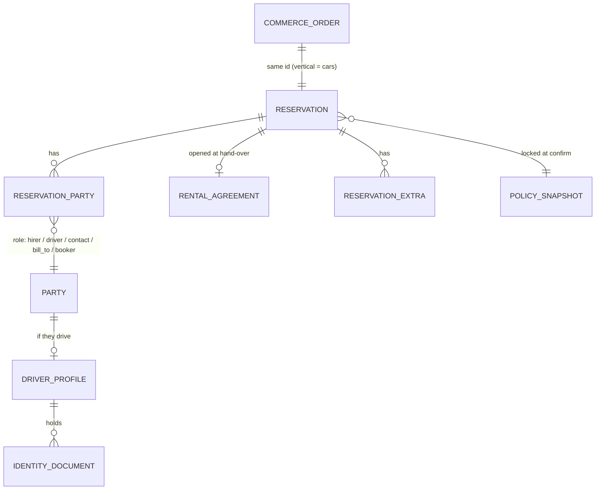
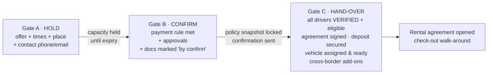
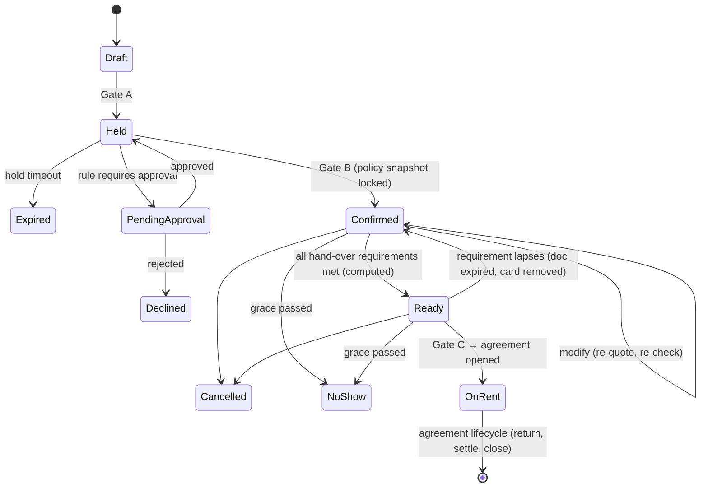

# Car rental booking flow (configurable)

Status: proposal, for review. Written 10 Nov 2026.
Scope: everything from the first search to "ready for pickup" (reservation), plus the hand-off into the
rental agreement (check-out). Event rentals keep their existing flow unchanged.
Related: [architecture.md](./architecture.md) (contexts, money, cells, agents) and
[dev-plan.md](./dev-plan.md) (phases).

---

## 0. Design in one page

1. **One booking engine, many channels.** Staff counter, phone, website widget, customer portal,
   WhatsApp/AI agent, broker import and corporate portal all call the **same commands** and the
   **same rules**. Channels differ only in *configuration*: which steps, in what order, and what can be
   finished later.
2. **Requirements are computed, not hard-coded.** A rules engine decides what a booking needs, e.g.
   "Emirates ID for residents; passport, visa and an IDP for some visitors; manager approval for an
   under-25 driver in a luxury car". The data comes from facts about this booking: driver, vehicle,
   branch, channel, dates and customer. Forms show exactly the fields that are needed, and nothing else.
3. **Three gates, progressive completion.** A booking passes **Hold → Confirm → Hand-over**. Each gate
   has a computed checklist. Missing items can be deferred to a later gate where configuration allows,
   so a customer can book in about 60 seconds and finish documents and signing later from a link.
4. **Declared vs verified facts.** What a customer types (date of birth, licence country) is *declared*.
   What a document check confirms is *verified*. Search and quotes may use declared facts. **The
   hand-over gate only accepts verified facts.**
5. **Everything is configurable within guardrails.**
   - Settings resolve through scopes: platform → jurisdiction → tenant → branch → class/model/vehicle
     → channel → rate plan → corporate account → booking override.
   - Every resolved value explains where it came from.
   - Settings are effective-dated, and a confirmed booking **locks** the policies it was sold under
     (like today's price locks).
   - Legal minimums from the jurisdiction pack can only be made stricter, never looser.
6. **The fast lane is the default.** A returning customer with a verified, unexpired profile and a
   saved card gets a 3-tap booking. Scanning a document (Emirates ID or licence MRZ/OCR) prefills
   forms, and the price updates live as you type (the same pattern as the event order builder).

---

## 1. Who is on a car booking (parties)

A car booking involves several people with different jobs. They are modelled as **roles on the
booking**, all pointing to the shared `parties` (customers) table:

| Role | Who | Required | Notes |
| --- | --- | --- | --- |
| `hirer` | The contracting party: a person or a company | always 1 | Signs the agreement (a company signs through an authorised person) |
| `primary_driver` | Main driver | always 1 | Often the same person as the hirer. Must pass eligibility |
| `additional_driver` | Extra drivers | 0..n (max by config) | Each one is checked. A daily fee per driver is configurable |
| `contact` | On-site or coordination contact: assistant, hotel concierge, family member | 0..n | Name, phone, relation. Can receive delivery updates. **Vehicle hand-over to a non-driver is off by default** |
| `bill_to` | Who pays: hirer, company, broker, insurer (replacement car) | 1 | Stored on the shared order header (invoices need it) |
| `booker` | Who made the booking: staff member, corporate booker, broker, agent | 1 | For audit, commission and corporate approval |



**Driver profile** (cars context, linked to a party):
- date of birth, nationality;
- residency (`resident`, `visitor` or `gcc_national`, per country);
- licence(s), a risk flag, and the verification state of each fact.

The profile is **reused across bookings**, so a returning driver's verified documents carry over until
they expire.

**Identity documents** (cars context, encrypted):

| Field | Notes |
| --- | --- |
| `type` | From a per-jurisdiction catalog (below) |
| `number_enc`, `number_hash` | Encrypted value + keyed hash (dedupe, blacklist match, without decrypting) |
| `issuer_country`, `issuer_region` | e.g. AE-DU, US-TX |
| `issued_on`, `expires_on` | Expiry must be after `return_at` + a configurable buffer |
| `licence_classes`, `licence_first_issued_on` | For "licence held ≥ N years" and vehicle category checks |
| `script` | latin / arabic / other. This drives IDP rules |
| `files` | Front, back and selfie (private storage, short-lived signed URLs) |
| `verification` | `declared` → `auto_verified` / `manually_verified` / `rejected`, with method (KYC vendor, UAE Pass, staff), who and when |
| `extracted` | MRZ/OCR fields, kept only until a person or the vendor confirms them |

**Document type catalog** (data, not code; tenants can add their own types):

| Jurisdiction | Typical types |
| --- | --- |
| UAE | `emirates_id` (front/back, `784-…` format check), `uae_driving_licence`, `passport`, `visa_or_entry_stamp`, `home_driving_licence`, `international_driving_permit`, `trade_licence` (company hirer) |
| Qatar | `qid`, `qatar_driving_licence`, `passport`, `visa_or_entry_stamp`, `home_driving_licence`, `international_driving_permit` |
| Oman | `oman_resident_card`, `oman_driving_licence`, `passport`, `visa_or_entry_stamp`, `home_driving_licence`, `international_driving_permit` |
| US | `us_driving_licence` (state), `passport` (international renters), `proof_of_return_travel` and `second_id` (debit-card rules), `proof_of_insurance` (if declining protection, where the tenant asks for it) |

Which documents are needed, and when, is **never hard-coded**. The rules engine decides (§4).

---

## 2. What is being booked (booking level and offers)

Each vehicle class is configured with a **booking level**:

| Level | Customer picks | Assignment | Typical use |
| --- | --- | --- | --- |
| `class` | "Compact SUV — Toyota RAV4 or similar" | Any VIN in the class, assigned late | Economy, mid-range, US airports |
| `model` | "Nissan Patrol 2025" (guaranteed model) | Any VIN of that model | Popular SUVs, monthly plans |
| `vehicle` | A specific car (photos, colour; plate hidden) | That VIN, held at booking | Luxury and exotic (Dubai), vans with fit-outs |

Search returns **offers**. An offer is: level, target id, price for the dates, availability state,
badges (free delivery, unlimited km), and the reasons it may be restricted for this customer. One
results list mixes levels, so a tenant can sell economy by class and supercars by vehicle.

Configurable per class or branch:

| Setting | Notes |
| --- | --- |
| Upgrade ladder | Which classes can fill a sold-out class: free upgrade (staff/system), paid upgrade (offered to the customer), never |
| Overbooking allowance | e.g. +2 cars or +5% per class, branch and date. **Never** for `vehicle` level; off by default |
| Hold expiry | How long an unpaid hold keeps capacity |
| Booking limits | Lead time, maximum advance, minimum and maximum duration per channel |
| Blackout dates | Dates the class cannot be booked |

---

## 3. Trip details (where and when)

| Field | Options (configurable) |
| --- | --- |
| Pickup mode | `branch` · `delivery` (address or hotel inside a delivery zone) · `airport` (meet & greet, flight number) |
| Return mode | `branch` (same or another; the one-way matrix decides) · `collection` (address in zone) · `airport` |
| Times | Branch opening hours, after-hours pickup/return (fee, key-box), minimum notice per mode |
| Delivery zones | Polygons per branch: fee (fixed, by distance, or free over N days), lead time, time slots, maximum per slot |
| Flight | Flight number and arrival time. Pickup grace is extended by the delay up to N hours before no-show |
| Cross-border | Countries requested (e.g. UAE → Oman). Eligibility per vehicle, required add-on (insurance/NOC), fee |

Delivery and collection **reuse the event crew dispatch and live map**. A delivery creates a driver
task with a time window, route and proof of hand-over (photos and signature in the field app).

---

## 4. Rules engine (how "everything configurable" works)

### 4.1 Facts
Rules read a typed **fact model** that the booking builds as it fills in. Each fact carries its
`source`: `declared`, `verified` or `system`.

```
booking:   channel, booking_level, pickup_at, return_at, duration_days, pickup_mode, return_mode,
           one_way, cross_border[], rate_plan.type (daily|weekly|monthly|subscription), total, currency
branch:    id, country, region, tags (airport, city), local_time, weekend_days
vehicle:   class.id, class.tags (luxury, van, ev), model.id, model.year, vehicle.id, value_band
customer:  kind (person|company), segment (corporate account id, VIP), blacklist_hit (none|soft|hard),
           history (rentals_count, unpaid_balance, damage_cases)
driver[]:  age, licence_held_years, licence_country, licence_script, residency, nationality,
           documents{type → status, expires_on}, is_primary
payment:   method (credit|debit|cash|broker|corporate), card_country, card_name_matches_driver
```

### 4.2 Rules
A rule is **data**: a condition over facts, then effects. It is stored as validated JSON (zod), edited
in Settings with a form builder, and evaluated by a **pure function** in the kernel. No arbitrary
code runs.

```json
{
  "id": "uae-visitor-licence",
  "scope": { "jurisdiction": "AE" },
  "when": { "all": [
    { "fact": "driver.residency", "op": "eq", "value": "visitor" },
    { "fact": "driver.licence_country", "op": "not_in", "value": { "list": "ae_accepted_home_licences" } }
  ]},
  "then": [
    { "effect": "require_document", "type": "international_driving_permit", "by": "handover" },
    { "effect": "require_document", "type": "passport", "by": "handover" },
    { "effect": "require_document", "type": "visa_or_entry_stamp", "by": "handover" }
  ],
  "locked": true,
  "message": { "en": "Visitors with this licence need an International Driving Permit.", "ar": "…" }
}
```

```json
{
  "id": "young-driver-luxury",
  "scope": { "tenant": true, "classTags": ["luxury"] },
  "when": { "all": [ { "fact": "driver.age", "op": "lt", "value": 25 } ] },
  "then": [ { "effect": "require_approval", "role": "manager", "reason": "Under 25 in a luxury car" } ]
}
```

**Effects:**

| Effect | Meaning |
| --- | --- |
| `deny` | Booking not possible, with a bilingual message |
| `require_approval` | Approval by a role (manager, fleet manager) |
| `require_document` | Document type, and the gate it is needed by (`confirm` or `handover`) |
| `require_field` | A built-in or custom field |
| `add_fee` | Code, amount, per day or per rental, taxable |
| `set` | Override a setting for this booking (e.g. deposit amount, km allowance) |
| `restrict` | Payment methods, pickup modes, channels or extras |
| `warn` | Shown to staff, not blocking |
| `suggest` | An upsell (e.g. full protection for first-time renters) |

**Conflict resolution** (deterministic and explainable):
1. `deny` beats `require_approval`, which beats everything else.
2. Requirements are combined, and the earliest gate wins.
3. Fees add up, de-duplicated by code, and the most specific scope wins on a duplicate code.
4. For `set`, the most specific scope wins, then the higher priority.

### 4.3 Guardrails
- **Jurisdiction packs** (AE, AE-DU, AE-SHJ, QA, OM, US and US states) ship legal-minimum rules
  marked `locked`. Tenants can add stricter rules, raise minimum ages and add documents. They can't
  remove or loosen locked rules. A tenant setting that crosses a bound fails validation with the
  reason shown.
- **Invariants in code** that are never configurable:
  - availability is checked at commit;
  - the hand-over gate needs verified facts for every driver;
  - an agreement is signed before hand-over;
  - card data never reaches our servers;
  - every override is audited with a reason.
- **Rule test bench:** in Settings, staff describe a sample booking (driver age 23, visitor, UK
  licence, luxury class, Dubai Marina delivery). They see every rule that fired and why, the fees,
  the documents, the gates and the final price. Each tenant's rules have saved test cases, and a
  rule change is blocked if it breaks a saved case unless the person confirms it.

### 4.4 Where rules run
| Moment | Facts | Purpose |
| --- | --- | --- |
| Search | declared (whatever is known) | Hide or flag offers ("needs approval", "not available for under 25") |
| Every step change | declared | Live checklist and price (browser, pure engine) |
| Gate check (server) | declared + verified | Authoritative pass or fail |
| Hand-over | **verified only** | Final check. The date of birth read from the document replaces the typed one |

---

## 5. Settings: scopes, effective dates and policy locks

### 5.1 Settings registry
Each context declares its settings once:

```ts
defineSetting('cars.deposit.amount', {
  schema: MoneyOrPercent, default: { kind: 'by_class' },
  scopes: ['tenant', 'branch', 'class', 'channel', 'rate_plan', 'corporate_account', 'booking'],
  editableBy: 'settings.cars.manage', bookingOverride: 'cars.override_deposit',
  lockOnConfirm: true, bounds: null, label: { en: 'Security deposit', ar: '…' },
});
```

The registry generates the Settings UI, validation, the API, agent-readable explanations and docs.
This extends today's versioned zod settings (`tenantPreferencesSchema`, location settings) instead of
replacing them.

### 5.2 Resolution order
`platform default → jurisdiction pack (bounds) → tenant → branch → vehicle class → model → vehicle → channel → rate plan → customer segment / corporate account → booking override (permission + reason)`

- The most specific scope wins, inside the jurisdiction bounds.
- `resolve(key, context)` returns the value **plus its provenance** ("AED 3,000, from class Luxury,
  set by Sara on 2 Nov"). Staff, customers and agents see the same explanation.
- Resolved settings are cached per `(tenant, config_version)`. Changing a setting bumps the version,
  which clears the cache.

### 5.3 Effective dates and locks
- Every settings change is a version with `effective_from`. Changes can be scheduled (e.g. new
  summer cancellation policy from 1 Jun) and are audited.
- At **confirm**, the booking stores a **policy snapshot**: the resolved values of every
  `lockOnConfirm` setting and the rule-set version, content-addressed so identical snapshots are
  shared. Rates and cancellation, no-show, deposit, mileage, fuel and late-return terms stay as sold.
- **Locked legal rules are always evaluated at their current version** at hand-over. A new legal
  requirement applies even to older bookings.
- Changing a confirmed booking (dates, class, extras) re-quotes. Whether the new rules or the locked
  ones apply is itself a setting (`cars.modify.reprice`: `locked_terms` | `current_terms` |
  `better_of`).

### 5.4 Presets
Onboarding offers presets that fill settings and rules in one go, and everything stays editable:
- **Dubai standard:** Sat–Sun weekend, AED, VAT 5% included, Salik pass-through + admin fee, deposit
  charge-and-refund after 21 days, delivery zones.
- **Dubai luxury:** vehicle-level booking, higher deposits, 25+ age, approval rules.
- **Monthly UAE:** subscription plans, km per month, swaps.
- **Doha**, **Muscat**.
- **US airport:** concession recovery fee, young-renter fee, debit-card rules.
- **US neighborhood:** a local branch rather than an airport.

---

## 6. The flow: steps, gates and the readiness checklist

### 6.1 Steps (building blocks)

| # | Step | Captures | Speed-ups |
| --- | --- | --- | --- |
| S1 | Search | pickup/return mode, place, date-time, (optional) driver age and residency | Remembers the last search. Offers update live |
| S2 | Choose | an offer (class, model or vehicle), rate plan (pay now vs later, daily vs monthly) | Upgrade and sell-up suggestions |
| S3 | Extras & protection | protection package, mileage plan, fuel option, child seats, extra drivers, cross-border, delivery slot | Tracked extras (child seats) use the **pooled** availability strategy. Bundles |
| S4 | Renter & drivers | hirer (person or company), primary driver, additional drivers, contacts | Phone/email lookup. **Scanning an Emirates ID or licence prefills** name, DOB, number and expiry |
| S5 | Documents | what the rules require (§4) | Upload from phone, scan at counter, KYC vendor, UAE Pass. Reused if already verified |
| S6 | Payment | payment option, deposit strategy, card guarantee, bill-to | Saved card, Apple Pay/Google Pay, payment link |
| S7 | Review & sign | totals, policies (locked terms), agreement e-signature, policy ticks | Signs online, or at the counter at hand-over |

### 6.2 Gates



- Each gate's checklist = **invariants + rule-driven requirements**, computed on the server and shown
  live in every channel.
- A step marked **deferrable** in the channel's flow can be finished after Gate B. The customer gets
  a "complete your booking" link, and reminders run in the background (messaging + KYC agent).
- **Readiness** is a computed state (`incomplete`, `ready_for_pickup`, `blocked`) shown on the yard
  board and in the reservation list. The goal is that most bookings are ready before pickup day, so
  the counter step is only the walk-around.

### 6.3 Flow definitions per channel (configurable)

A flow definition says which steps appear, in what order, which can be deferred, and the
channel-specific limits. Defaults:

| Channel | Steps before Confirm | Deferred to before hand-over | Notes |
| --- | --- | --- | --- |
| Staff counter / phone | S1 S2 S3 S4 S6 | S5 S7 (if the customer isn't present) | One-screen builder with a "Still required" sidebar (the events POS pattern). Target ≤ 90 s for a returning customer |
| Website widget / portal | S1 S2 S3 S4 (primary driver basics) S6 | S5, extra drivers, S7 | ≤ 4 screens to confirm. Instant eligibility pre-check from declared age and residency |
| WhatsApp / AI agent | S1 S2 S3 S4 → payment **link** | S5 via **secure upload link** (not chat attachments, by default) | Same commands. Agent autonomy per step (architecture §9) |
| Broker / marketplace | imported as confirmed (bill-to broker, voucher, prepaid amount) | S4 extra drivers, S5, S6 deposit, S7 | Counter collects deposit, extras and any balance |
| Corporate portal | S1 S2 S3 S4 (pick from authorised drivers) + PO | S5 (if not on file), S7 | Bill-to company, credit limit, monthly statement |
| Monthly / subscription | S1 S2 S3 S4 S5 S6 S7 (all before confirm, by default) | — | Longer KYC. Recurring billing. Swap schedule |

Tenants can reorder steps, add custom fields (typed, with show-if rules, per channel), make deferrable
steps mandatory, add approval steps, and switch channels on or off. Invariants stay in place.

### 6.4 Payment and deposit options (configurable per channel, rate plan and segment)

| Option | Gate B is met when | Notes |
| --- | --- | --- |
| `pay_now_full` | Captured | Often a cheaper, non-refundable "pay now" rate plan |
| `pay_now_partial` | Deposit % captured | The rest is due at pickup or auto-charged |
| `pay_at_pickup_guaranteed` | Card authorised or saved (zero or small auth) | The no-show fee can be charged to it |
| `pay_at_pickup_unguaranteed` | Nothing | Off by default. Can be limited to known customers |
| `broker_prepaid` | Voucher imported | Bill-to broker. The customer pays extras and the deposit at the counter |
| `corporate_invoice` | Within credit limit | Monthly statement. PO required by setting |
| `cash` | Staff records cash | Counter only. Configurable |

The **security deposit** is separate from paying for the rental:
- strategy: `auth_hold` · `charge_and_refund` · `no_deposit` (+ surcharge) · `none`;
- amount by class, rate plan or rule;
- timing: at confirm or at hand-over;
- release window in days after return, for fines and tolls.

### 6.5 Cancellation, changes and no-show (policy objects, locked at confirm)
- **Cancellation tiers:** e.g. free until 48 h before pickup, then 1 day's rent, then 100% within
  2 h. The amount can be fixed, a percentage, or N days. Settings can differ per rate plan and
  channel. A broker's own policy can be imported.
- **Changes:** free until X hours. Repricing follows `cars.modify.reprice`. A class change re-checks
  availability and the upgrade ladder.
- **No-show:** grace after the pickup time, extended by the flight delay. Then automatic no-show:
  release capacity, charge the fee on the guaranteed card, and notify the customer.
- **Hold expiry:** unpaid holds release capacity at `hold_expires_at`, with a reminder before.

---

## 7. State machine (reservation)



The header `commerce.orders.stage` mapping:

| Stage | Statuses |
| --- | --- |
| draft | Draft |
| open | Held, PendingApproval |
| confirmed | Confirmed, Ready, OnRent |
| completed | agreement closed |
| cancelled | Expired, Declined, Cancelled, NoShow (with fee) |

---

## 8. Availability rules the flow relies on

- **Class and model levels:** supply minus holds ≥ 1 under an advisory lock, plus the overbooking
  allowance where configured.
- **Vehicle level:** an exclusion constraint on that VIN, at hold time.
- **Overdue rentals keep their car blocked** until it is checked in. Future bookings of the same VIN
  or tight class supply are flagged **at risk**, and the fleet agent suggests a swap.
- **One-way** returns add supply at the return branch from the return time plus turnaround.
- **Holds count**, but expire. Broker imports are confirmed immediately and can trigger the upgrade
  ladder.
- **Tracked extras** (child seats, GPS units) use the pooled strategy at the pickup branch.

---

## 9. Data model (cars schema, booking part)

```
cars.reservations            1:1 with commerce.orders (vertical='cars'), composite FK incl. vertical
  status, channel, source_ref (broker voucher, corporate PO), booking_level,
  class_id, model_id, vehicle_id (vehicle level), rate_plan_id,
  pickup_mode, pickup_branch_id, pickup_zone_id, pickup_address (line1…, lat, lng), pickup_at, flight_no,
  return_mode, return_branch_id, return_zone_id, return_address…, return_at,
  mileage_plan, fuel_option, protection_package_id, cross_border text[],
  payment_option, deposit_strategy, deposit_amount_minor, hold_expires_at, no_show_after,
  readiness (computed: state + missing[]), policy_snapshot_id, custom_fields jsonb (tenant fields only),
  version, created_by_actor
cars.reservation_parties     reservation_id, party_id, role, driver_profile_id, sort, relation, can_receive_vehicle
cars.driver_profiles         party_id, dob, nationality, residency (+ source per fact), risk_flag
cars.identity_documents      driver_profile_id, type, number_enc, number_hash, issuer_*, issued_on, expires_on,
                             licence_*, script, file_ids[], verification (status, method, by, at), extracted (temp)
cars.reservation_extras      reservation_id, extra_id, qty, pricing (per_day|per_rental|capped), commerce_line_id
cars.classes / models / vehicles / extras / protection_packages / rate_plans / delivery_zones
cars.policies                cancellation, no_show, modification, deposit, late_return (versioned, effective_from)
platform.settings_values     scope_type, scope_id, key, value jsonb, version, effective_from, set_by
platform.rules               id, context, scope, when jsonb, then jsonb, locked, priority, version, effective_from
platform.rule_tests          tenant saved test cases for the rule bench
platform.policy_snapshots    id (content hash), resolved jsonb, rule_set_version
platform.approvals           subject, requested_by (human or agent), rule_id, reason, decided_by, decision
commerce.orders              (shared header) + bill_to_party_id, payer_kind (customer|company|broker|insurer)
```

`platform.approvals` is the **same inbox** used for agent proposals (architecture §9), so a manager
has one queue for "approve under-25 luxury" and "approve agent's 15% discount".

---

## 10. Commands (contract excerpt)

```
cars.search.offers            (query, read)          → offers[] with price, availability, restrictions
cars.reservations.hold        (reversible_write)     Gate A
cars.reservations.update      (reversible_write)     any step; returns new quote + checklist (dryRun supported)
cars.reservations.addParty / removeParty / setPrimaryDriver
cars.documents.attach         (pii_access)           upload/scan/KYC result → verification flow
cars.documents.verify         (pii_access)           staff manual verification (permission)
cars.reservations.confirm     (money_movement)       Gate B; locks policy snapshot
cars.reservations.modify      (reversible_write)     re-quote under cars.modify.reprice
cars.reservations.cancel      (money_movement)       applies locked cancellation policy
cars.reservations.markNoShow  (money_movement)       system or staff
cars.reservations.readiness   (query)                checklist for Gate C
cars.agreements.open          (irreversible)         Gate C → check-out
platform.approvals.decide     (permission-bound)
```

Every command returns the **checklist** and the **explained quote**. Every UI, the agent and the
public API render the same truth.

---

## 11. Streamlining targets (measured from day one)

| Metric | Target |
| --- | --- |
| Counter booking, returning verified customer | ≤ 90 s, ≤ 10 taps |
| Counter booking, new customer with ID scan | ≤ 3 min |
| Website: screens to confirm | ≤ 4. Live quote < 200 ms in the browser |
| Bookings `ready_for_pickup` before pickup day | ≥ 70% (KYC and sign links + reminders) |
| Hand-over at counter when ready | ≤ 2 min (walk-around only) |
| No-show rate on guaranteed bookings | Tracked per channel; drives the overbooking allowance |

---

## 12. Open questions for the owner

1. **Document types and accepted home-licence lists** per country. The presets need a reviewed list
   for AE, QA, OM and US states.
2. **WhatsApp document intake:** allow ID photos sent in chat (common in practice), or only the secure
   link (the recommended default)?
3. **Chauffeur-driven** rentals: in scope (a driver resource and hourly pricing) or later?
4. **Insurance-replacement** bookings (insurer pays): needed for the US pilot?
5. **Broker integrations:** which brokers and marketplaces the pilots actually get bookings from
   (import by API, by email parsing, or manual entry first).
6. **Pilot data:** 50–100 real past bookings per pilot to build the rule presets and pricing golden
   cases.
